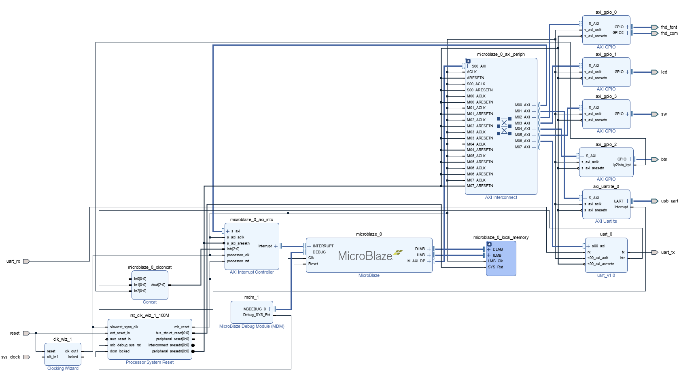
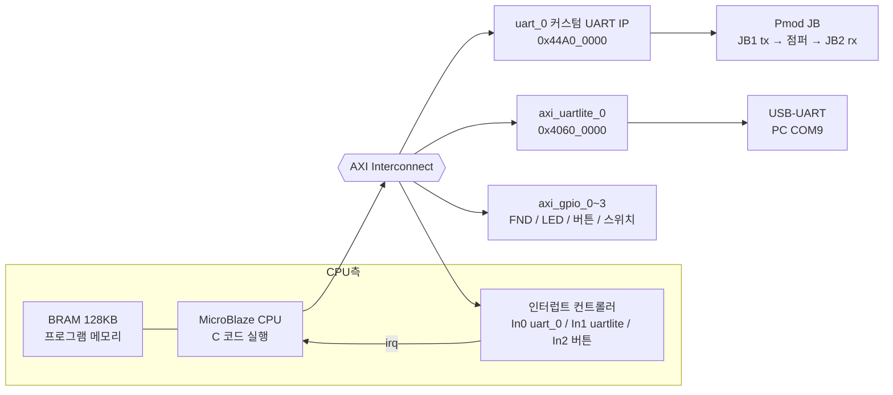
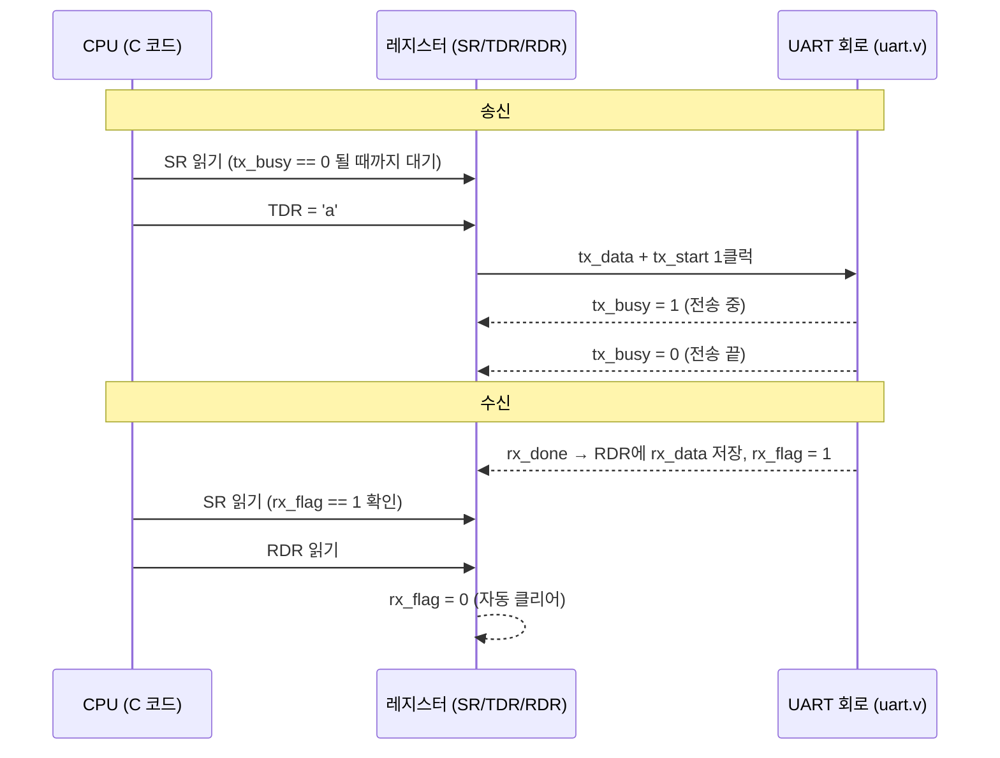
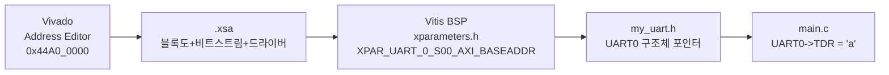
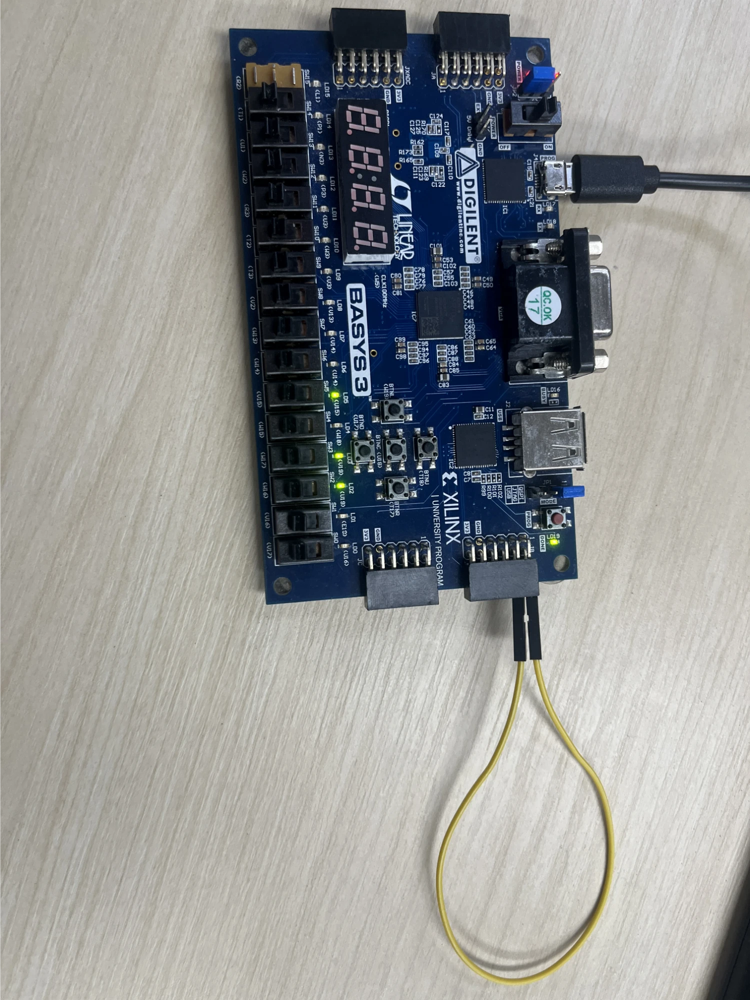
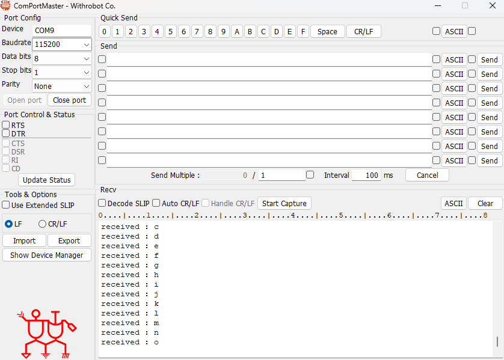

# MicroBlaze + 커스텀 AXI4-Lite UART

> 직접 설계한 UART 회로를 AXI4-Lite IP로 패키징해 MicroBlaze 시스템에 연결하고,
> C 코드로 송수신하는 루프백 테스트를 Basys3 보드에서 **성공**함.

- 작성일: 2026-11-25
- 환경: Vivado / Vitis 2020.2, Basys3 (xc7a35tcpg236-1), 100MHz, 115200 baud
- 용어 설명, 전체 핀/주소 표, 트러블슈팅 전체 목록: [docs/APPENDIX.md](docs/APPENDIX.md)

---

## 1. 요약

| 항목 | 내용 |
| --- | --- |
| 만든 것 | AXI4-Lite 슬레이브 UART IP (`uart_v1.0`, 레지스터 SR/TDR/RDR/CR) |
| 붙인 곳 | MicroBlaze 시스템, 주소 `0x44A0_0000` |
| 검증 방법 | JB1(tx) ↔ JB2(rx) 점퍼 루프백, 'a'~'z'를 1초마다 송신 후 수신 |
| 결과 | `received : c, d, e … o` 1초마다 순서대로 출력 → **송신·수신 경로 정상** |

---

## 2. 시스템 블록도



- Vivado Block Design 원본 화면 (`design_1.bd`)
- 왼쪽: 클럭(clk_wiz_1), 리셋(rst_clk_wiz_1_100M), MicroBlaze, 인터럽트 컨트롤러(axi_intc + xlconcat)
- 가운데: AXI Interconnect (M00~M07 → 주변장치)
- 오른쪽: axi_gpio_0~3, axi_uartlite_0, **uart_0 (커스텀 IP, uart_v1.0)** → 외부 포트
- uart_0: `tx` → `uart_tx`(JB1), `uart_rx`(JB2) → `rx`, `intr` → xlconcat In0

<details>
<summary>간략도 (연결 관계만)</summary>



</details>

- CPU는 모든 주변장치를 **메모리 주소**로 읽고 쓴다 (memory-mapped I/O)
- `uart_0`만 직접 만든 IP이고, 나머지는 Xilinx 기본 IP
- 결과 출력은 Xilinx Uartlite(USB)를 통해 PC 터미널로 확인

---

## 3. 커스텀 UART IP

### 3.1 레지스터 맵

| 오프셋 | 이름 | 접근 | 비트 |
| --- | --- | --- | --- |
| 0x00 | SR (상태) | R | [0] `tx_busy` 송신 중=1 · [1] `rx_flag` 새 글자 도착=1 |
| 0x04 | TDR (송신) | W | [7:0] 쓰면 즉시 송신 시작 (`tx_start` 1클럭 펄스) |
| 0x08 | RDR (수신) | R | [7:0] 받은 글자, 읽으면 `rx_flag` 자동 0 |
| 0x0C | CR (제어) | RW | [0] `rx_ie` 1이면 수신 완료 시 `intr` 발생 |

### 3.2 송수신 순서 — 하드웨어와 소프트웨어의 약속

- 핵심은 **SR**: CPU는 SR을 보고 "지금 보내도 되나", "읽을 글자가 있나"를 판단



### 3.3 IP 패키징

- 위치: [`ip_repo/uart_1.0`](ip_repo/uart_1.0) (Vivado Create and Package IP)
  - 로컬 Vivado 프로젝트는 `../ip_repo`를 IP 저장소로 참조. 이 저장소를 받아 쓸 때는 Settings → IP → Repository에 `ip_repo` 폴더를 추가
- 효과: 다른 프로젝트 IP Catalog에서 Xilinx IP처럼 꺼내 사용
- 구성: `hdl/`(Verilog 3개), `drivers/uart_v1_0/`(Vitis 드라이버), `component.xml`(IP 설명서)

---

## 4. 주소가 C 코드까지 오는 흐름



- 레지스터를 구조체로 묶고, 베이스 주소를 구조체 포인터로 변환 (STM32 HAL과 같은 방식)
- 구조체 멤버 순서 = 오프셋 (4바이트씩 → 0x00, 0x04, 0x08, 0x0C)
- `volatile` 필수: 하드웨어가 값을 바꾸므로 컴파일러가 읽기를 생략하면 안 됨

```c
typedef struct {
    volatile uint32_t SR;   // 0x00
    volatile uint32_t TDR;  // 0x04
    volatile uint32_t RDR;  // 0x08
    volatile uint32_t CR;   // 0x0C
} UART_TypeDef;

#define UART_BASEADDR XPAR_UART_0_S00_AXI_BASEADDR   // 0x44A00000
#define UART0 ((UART_TypeDef *)UART_BASEADDR)

void UART_Transmit(UART_TypeDef *uart, uint8_t data) {
    while (uart->SR & UART_SR_TX_BUSY);   // 송신 중이면 대기
    uart->TDR = data;                     // 쓰는 순간 송신 시작
}

uint8_t UART_Receive(UART_TypeDef *uart) {
    while (!(uart->SR & UART_SR_RX_FLAG)); // 글자 올 때까지 대기
    return (uint8_t)uart->RDR;             // 읽으면 rx_flag 자동 0
}
```

- 테스트 루프 (`main.c`)

```c
UART_Transmit(UART0, tx_data);
if (tx_data == 'z') tx_data = 'a'; else tx_data++;
sleep(1);
if (UART_RxAvalable(UART0)) {
    rx_data = UART_Receive(UART0);
    xil_printf("received : %c \n", rx_data);
}
```

---

## 5. 검증

| 항목 | 결과 |
| --- | --- |
| uart_0 주소 / 핀 (A14 JB1, A16 JB2) | 확인 (구현 결과, `xparameters.h`) |
| PC 콘솔 `start, UART0 = 0x44a00000` | 확인 |
| 루프백 `received : …` 1초마다 | **확인** |

<p>
  
  
</p>

- 왼쪽: Pmod JB 윗줄 1번(JB1, tx)과 2번(JB2, rx)을 점퍼로 연결, DONE LED 점등
- 오른쪽: ComPortMaster(COM9, 115200)에 글자가 1초마다 차례로 수신됨
- 검증된 경로: CPU → TDR → JB1 → 점퍼 → JB2 → RDR → CPU → PC 콘솔

---

## 6. 트러블슈팅 핵심

| 증상 | 원인 | 해결 |
| --- | --- | --- |
| `UART0 = 0x00000000` (1) | Vitis가 uart_0 추가 전의 예전 xsa 사용 | 새 xsa로 Update Hardware Specification + 플랫폼 재빌드 |
| `UART0 = 0x00000000` (2) | 드라이버 tcl이 `C_S00_AXI_BASEADDR`를 찾음 (실제 이름 `C_BASEADDR`) | `drivers/uart_v1_0/data/uart.tcl`에서 주소 매크로 직접 생성 |
| Vitis 빌드 `mb-ar *.o: Invalid argument` | 윈도우 CMD가 Makefile 와일드카드 `*.o`를 못 풂 | 드라이버 Makefile을 `$(wildcard ...)`로 변경 |

- **교훈**: 하드웨어를 바꾸면 반드시 아래 순서를 끝까지 진행

```text
블록도 수정 → 비트스트림 → xsa export → Vitis Update Hardware Spec → 플랫폼 재빌드 → 앱 빌드
```

- 하나라도 빠지면 C 코드가 **예전 회로** 기준으로 동작 (주소 0, 포트 없음 등)

---

## 7. 남은 일

- [x] 루프백 수신 확인
- [ ] `fix_gpio_out.tcl` 실행 → LED/FND GPIO를 출력으로 변경 후 xsa/플랫폼 갱신
- [ ] CR.`rx_ie`를 켜고 인터럽트(In0)로 수신하는 버전

---

## 폴더 구조

```text
20261124_MicroBlaze_GPIO_UART/
├─ README.md                 이 문서
├─ docs/APPENDIX.md          상세 자료 (용어, 전체 표, 에러 목록)
├─ ip_repo/uart_1.0/         패키징된 UART IP (hdl, drivers, component.xml)
├─ *.srcs/                   블록도(design_1.bd), XDC
├─ xsa/design_1_wrapper.xsa  Vitis로 넘기는 하드웨어 파일
├─ rebuild_all.tcl           IP 갱신 → 배선 → 비트스트림 → xsa 일괄 실행
├─ fix_gpio_out.tcl          LED/FND 출력 전환 (미실행)
└─ vitis_workspace/
   └─ hello_uart/src/
      ├─ main.c
      └─ driver/my_uart/     커스텀 UART 드라이버
```

- Vivado/Vitis 생성물(.runs, .gen, Vitis 플랫폼 등)은 제외. 블록도와 xsa로 다시 만들 수 있음
